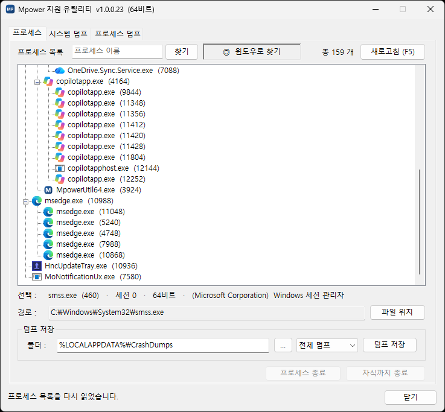
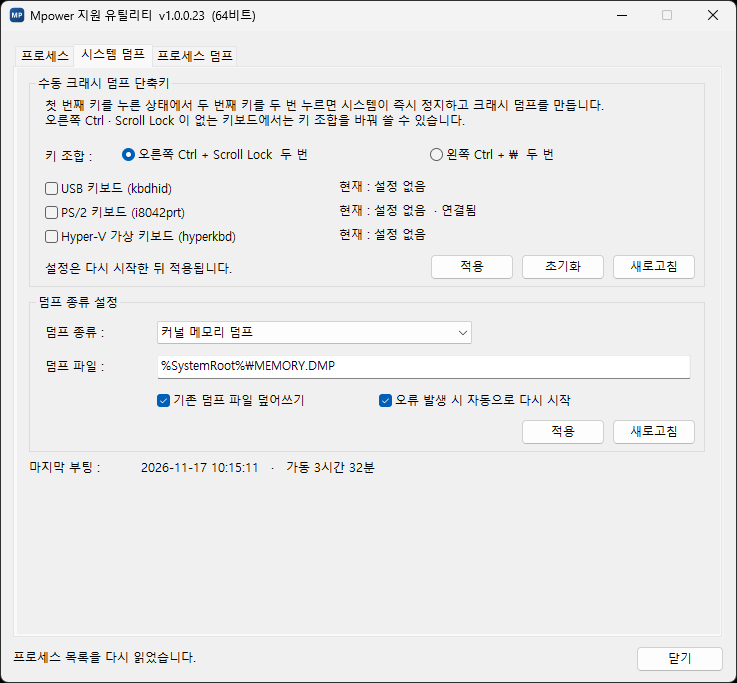
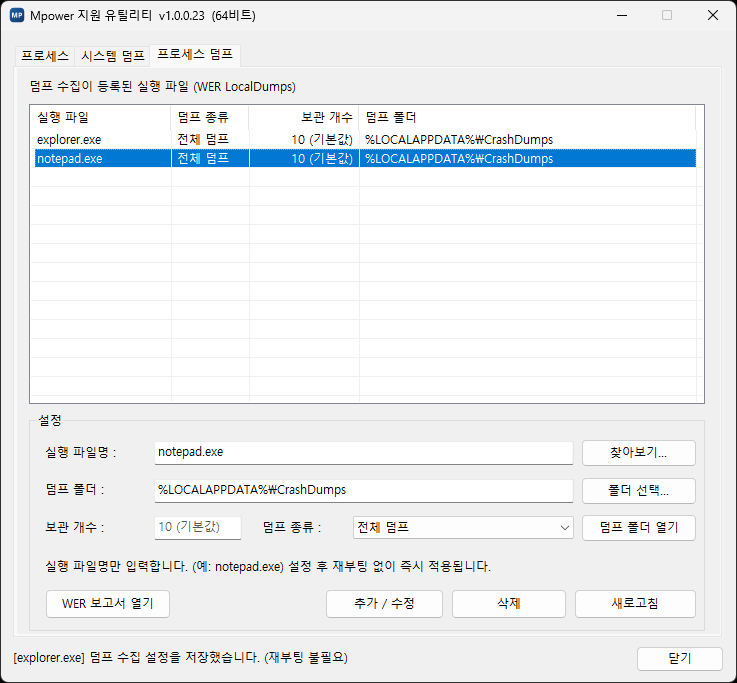

# MpowerUtil

Windows 장애 분석에 자주 쓰는 **프로세스 조회·종료·즉시 덤프**와 **크래시 덤프 자동 수집 설정**을
할 수 있는 관리자용 유틸리티입니다.

[English](#english)

## 다운로드

[Releases](../../releases/latest) 에서 `MpowerUtil_vX.Y.Z.W.zip` 을 내려받아 압축을 풉니다.

- `MpowerUtil32.exe` 와 `MpowerUtil64.exe` 가 들어 있습니다.
- 64비트 Windows 에서 32비트 프로세스 덤프를 생성하려면 32비트 버전이 필요합니다.
- 설치가 필요 없으며, 디지털 서명된 파일입니다.

## 실행 환경

- Windows 10 / 11 (32비트·64비트)
- **관리자 권한이 필요합니다.**

## 기능

### [프로세스] 탭

- 실행 중인 프로세스를 **부모-자식 트리**로 표시하고, 이름으로 찾거나 **창을 가리켜 찾을 수 있습니다**
  ([◎ 윈도우로 찾기] 를 누른 채 대상 창 위로 끌어 놓기).
- 항목을 더블 클릭하면 원본 파일명·제품 이름·파일 버전·**디지털 서명자**(카탈로그 서명 포함)·
  패키지명·명령줄 등 상세 정보를 볼 수 있습니다. 값은 복사할 수 있습니다.
- **[덤프 저장]** 으로 선택한 프로세스의 미니/전체 덤프를 생성할 수 있습니다.
- **[프로세스 종료] · [자식까지 종료]** 로 강제 종료합니다.

### [시스템 덤프] 탭

- **수동 크래시 덤프 단축키**를 설정합니다. 기본 `오른쪽 Ctrl + Scroll Lock` 외에 Scroll Lock 이 없는
  키보드를 위한 대체 키 조합을 고를 수 있습니다. 설정과 해제 모두 **재부팅 후 적용**됩니다.
- **덤프 종류**(작은 메모리·커널·전체·활성·자동 메모리 덤프)와 덤프 파일 경로, 덮어쓰기·자동 다시 시작을
  Windows [시작 및 복구] 와 같은 방식으로 설정합니다.

### [프로세스 덤프] 탭

- 지정한 실행 파일이 크래시되면 Windows 오류 보고(WER)가 **덤프를 자동으로 남기도록** 등록합니다
  (`LocalDumps`). 덤프 폴더·보관 개수·덤프 종류를 실행 파일별로 지정할 수 있고, 재부팅 없이 바로 적용됩니다.
- **[덤프 폴더 열기] · [WER 보고서 열기]** 로 남은 덤프와 오류 보고서 폴더를 열 수 있습니다.

## 주의

- 프로세스 강제 종료와 메모리 덤프 기능 때문에 일부 백신·EDR 제품이 경고할 수 있습니다.

## 라이선스

개인·기업·기관 누구나 **무료로 사용**할 수 있습니다. 단, **재배포는 허용하지 않습니다.**
다른 사람과 공유할 때는 이 페이지의 링크를 알려 주십시오. 수정, 역설계, 판매는 금지되며 무보증으로 제공됩니다.
자세한 조건은 [LICENSE](LICENSE) 를 참고하십시오.

---

## English

**MpowerUtil** is an administrator utility for Windows troubleshooting that provides
**process inspection, termination and on-demand dumps** and **automatic crash dump settings**.
The user interface is in Korean.

### Download

Download `MpowerUtil_vX.Y.Z.W.zip` from [Releases](../../releases/latest) and extract it.

- It contains `MpowerUtil32.exe` and `MpowerUtil64.exe`.
- To create a dump of a 32-bit process on 64-bit Windows, the 32-bit version is required.
- No installation is needed, and the files are digitally signed.

### Requirements

- Windows 10 / 11 (32-bit and 64-bit)
- **Administrator rights are required.**

### Features

#### Process tab

- Shows running processes as a **parent-child tree**. You can find a process by name, or **by pointing at its window**
  (press and hold the finder button, then drag it onto the target window).
- Double-click an item to see details such as the original file name, product name, file version,
  **digital signer** (including catalog signatures), package name and command line. All values can be copied.
- **Save Dump** creates a mini or full dump of the selected process.
- **Terminate** and **Terminate with children** force-close processes.

#### System Dump tab

- Sets up the **manual crash dump hotkey**. In addition to the default `Right Ctrl + Scroll Lock`,
  you can choose an alternative key combination for keyboards without Scroll Lock. Both enabling and disabling **take effect after a reboot**.
- Sets the **dump type** (small memory, kernel, complete, active or automatic memory dump), the dump file path,
  overwrite and automatic restart, in the same way as the Windows *Startup and Recovery* dialog.

#### Process Dump tab

- Registers executables so that Windows Error Reporting (WER) **automatically keeps a dump** when they crash
  (`LocalDumps`). The dump folder, number of dumps to keep and dump type can be set per executable, and take effect without a reboot.
- **Open Dump Folder** and **Open WER Reports** open the folders that hold the collected dumps and error reports.

### Notes

- Some antivirus or EDR products may warn about this tool because it can terminate processes and write memory dumps.

### License

Free to use for anyone, including individuals, companies and organizations. **Redistribution is not permitted.**
To share it, please share a link to this page instead. Modification, reverse engineering and resale are prohibited,
and the software is provided without warranty. See [LICENSE](LICENSE) for the full terms.

---

Copyright (c) 2026, Innotena
